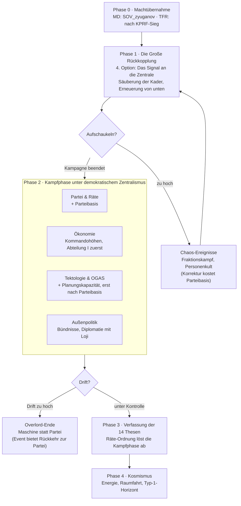

> **Hinweis (31.10.2026):** Für Teilprojekt 1 gilt die Spec `docs/specs/2026-10-31-tp1-md-phase1-design.md`. Wo sie abweicht (Einstieg per Entscheidung und eigener Fokusbaum statt vierter Fokus in `05_russia.txt`, Führungsfigur Darja Wolnowa, Startgeister), geht die Spec vor.

# CML-Submod Russland – Konzept (MD + TFR)

Stand: 31.10.2026

## Leitidee

Der Submod gibt Russland einen spielbaren CML-Pfad, in dem Planungskapazität erkämpft wird statt vom Himmel zu fallen. Das ist der bewusste Gegenentwurf zu Loji in TFR, wo die KI einfach da ist und regiert.

Drei Regeln tragen das Design:

- **Klassenkampf ist das Substantiv, „cyber“ das Adjektiv.** Kybernetische Fokusse schalten sich erst frei, wenn die politische Basis steht (Partei, Räte, Gewerkschaften). Wer die Reihenfolge umdreht, landet in der Overlord-Falle.
- **Zwei Phasen, zwei Verfassungen.** In der Kampfphase gilt demokratischer Zentralismus. Die 14 Thesen beschreiben erst die Verfassung der CML-Gesellschaft und werden spät im Baum als Ziel-Zustand umgesetzt.
- **Lakatos statt Dogma.** Der harte Kern ist fix, der Gürtel besteht aus einzeln prüfbaren Programmen (Pilotprojekte), die scheitern dürfen. Ein gescheitertes Pilotprojekt kostet Ressourcen, beschädigt aber nicht den Kern, sofern die Selbstkritik-Entscheidung gewählt wird.

Theoretische Bausteine im Baum: Bogdanovs Tektologie, russischer Kosmismus, Stafford Beers VSM, Glushkovs OGAS als historischer Anker, gramscianische Hegemonie. Horizont des Endausbaus ist eine Kardaschow-Typ-1-Zivilisation.

## Ausgangslage in Millennium Dawn

In MD ist der Einstieg politisch: Die Kommunisten sind 2000 schon die zweitstärkste Kraft, der CML-Pfad muss sie nur an die Macht bringen. Russland läuft unter dem Tag `SOV`, regiert von Emerging Reactionary mit 41,3 %, dahinter Emerging Communism mit 28,3 % ([MD: Russia](https://millenniumdawn.github.io/Millennium-Dawn/countries/russia/)).

| Punkt | Stand in MD | Andockpunkt für CML |
| --- | --- | --- |
| Startlage 2000 | 58 Divisionen, 35 Fabriken (26 Militär, 2 zivil), 40 Mrd. $ Kasse, 1.349 Mrd. $ Schulden; Krieg gegen Tschetschenien | Wirtschaftsumbau als Kern: von Rüstung und Rente zu ziviler Planung |
| Nationale Geister | Russian Legacy, Rentier State, Corrupt Oligarchi | Werden im Baum gezielt abgebaut und ersetzt |
| Ideologiesystem | Outlooks mit Subideologie-Slots; Emerging (communism) hat u. a. `communist_state` (Index 4) ([Scripted Effects](https://millenniumdawn.github.io/Millennium-Dawn/dev-resources/scripted-effects-reference/)) | CML als eigene Partei auf Slot 4, Lokalisierung `SOV.communist_state` |
| Bestehende Äste | u. a. Kasyanov, Zhirinovsky, Rosgardia, Democratic Referendum ([Changelog 1.11](https://millenniumdawn.github.io/Millennium-Dawn/changelogs/v1-11-0-missiles-holidays-and-snatch-and-grabs)) | Neuer Ast neben diesen, freigeschaltet über Machtübernahme |
| Systeme | Internal Factions (z. B. `change_labour_unions_opinion`), Produktivität, Network Infrastructure, Microchip-Werke, Research Facilities, Energie | Kybernetik-Fokusse wirken über diese Systeme statt über Vanilla-Boni |

Politische Hebel sind dokumentiert: `add_relative_party_popularity`, `change_ruling_party_effect` mit `rul_party_temp`, Parteiverbote über `ban_party_scripted_call` ([Scripted Effects](https://millenniumdawn.github.io/Millennium-Dawn/dev-resources/scripted-effects-reference/)).

**Geklärt (Repo-Stand `12497ea`, 31.10.2026): MD hat einen eigenen KPRF-Ast.** In `common/national_focus/05_russia.txt` (Baum `russia_focus`) hängen 67 Fokusse an `SOV_zyuganov` (Suchfilter `FOCUS_FILTER_RUSSIA_CPRF`). Wir zweigen also ab und bauen nicht neu.

- **Einstieg:** `SOV_zyuganov` (Voraussetzung `SOV_reign_of_yeltsin`), verfügbar bei `emerging_communist_state_are_in_power` oder `neutrality_neutral_communism_are_in_power`. Der Fokus setzt die Regierungspartei per `change_ruling_party_effect` auf Index 4 (`communist_state`).
- **Erste Gabelung (gegenseitig ausschließend):** `SOV_communist_party_dominance` (→ Parteimacht, Säuberungen/Restalinisierung, UdSSR-Wiedervereinigung) · `SOV_honor_gorbachevs_legacy` (→ Mehrparteiensystem, Perestroika) · `SOV_national_patriotic_alliance` (→ Allianz, christlicher Kommunismus, RSFSR).
- **Vorhandene Wirtschafts-/Technikfokusse im Ast:** `SOV_first_two_year_plan`, `SOV_a_second_two_year_plan`, `SOV_civilian_industrial_councils`, `SOV_scientific_councils`, `SOV_soviet_academy_of_sciences`, `SOV_red_cyber_army` sowie `SOV_automation_for_the_people` (Internet-Forschungsbonus, folgt auf `SOV_socialist_humanism`). Die Kybernetik-Fokusse dürfen das nicht doppeln, sie bauen darauf auf.
- **Vorhandene Mechanik:** dynamischer Modifier `SOV_revived_politburo_modifier` (`common/dynamic_modifiers/99_SOV_dynamic_modifiers.txt`) mit Variablen wie `SOV_revived_politburo_communism_support` und `SOV_revived_politburo_drift_defence_factor`. Das ist der natürliche Andockpunkt für die Parteibasis.
- **Folge für die Ideologie:** Slot 4 `communist_state` ist bereits die KPRF. Benennen wir ihn für CML um, heißt auch Zyuganovs Partei so. Sauberer: CML bleibt auf Slot 4 und wird nur über eine Lokalisierung umbenannt, die an ein Flag gebunden ist (`SOV_cml_path`), sobald der CML-Fokus genommen ist. Die freien Typen der Gruppe Emerging (`Conservative`, `Autocracy`, `anarchist_communism`) passen inhaltlich nicht.
- **Abzweigpunkt (entschieden 31.10.2026):** CML ist die vierte, gegenseitig ausschließende Option in der Gabelung nach `SOV_zyuganov`. Der neue Fokus `SOV_cml_signal_to_the_centre` („Das Signal an die Zentrale“) steht bei `x = 1, y = 1` relativ zu `SOV_zyuganov`, rechts neben `SOV_communist_party_dominance` (`x = -2`), `SOV_honor_gorbachevs_legacy` (`x = -5`) und `SOV_national_patriotic_alliance` (`x = -8`). Die drei bestehenden Fokusse bekommen je ein `mutually_exclusive = { focus = SOV_cml_signal_to_the_centre }`. Das ist der einzige Eingriff in die MD-Datei, der Rest kommt aus eigenen Dateien.
- **Interessengruppen für die Säuberung:** Russland startet mit `oligarchs`, `fossil_fuel_industry` und `intelligence_community`. MD kennt außerdem `communist_cadres` (alte Parteikader) und `labour_unions`, jeweils mit `change_<gruppe>_opinion`-Effekten. Der Russland-Fokusbaum nutzt `communist_cadres` bisher nicht.

## Ausgangslage in The Fire Rises

In TFR existiert der kommunistische Weg schon: Der CML-Pfad hängt sich an den KPRF-Sieg und gewinnt den Machtkampf innerhalb der Partei. TFR spielt in einem alternativen 2020 ([TV Tropes](https://tvtropes.org/pmwiki/pmwiki.php/VideoGame/TheFireRisesMod)). Nach Putins Tod gibt es eine Neuwahl; wer die KPRF über 50 % Einfluss im „House of Cards“ bringt, regiert ([TFR-Wiki](https://the-fire-rises-unoffical-database.fandom.com/wiki/Russian_Federation)).

| Punkt | Stand in TFR | Andockpunkt für CML |
| --- | --- | --- |
| Machtübernahme | KPRF gewinnt, restauriert die RSFSR, United Russia wird verboten ([Miraheze-Wiki](https://thefireriseswiki.miraheze.org/wiki/The_Fire_Rises_Wiki)) | Bleibt unverändert, CML zweigt danach ab |
| Innerparteilicher Kampf | Balance of Power „Intra-Party Competition“: Apparatschiks gegen Aktivisten; Rashkin kommt über die Aktivisten-Seite ([Wiki: CPRF](https://thefireriseswiki.miraheze.org/wiki/Russian_Federation/CPRF)) | CML als dritte Strömung oder als Aktivisten-Unterpfad |
| Wirtschaftsbaum | Wahl zwischen „Adaptation to the Chinese Model“ und „Developed Socialism“ (Teaser, Stand 2022) ([Wiki: CPRF](https://thefireriseswiki.miraheze.org/wiki/Russian_Federation/CPRF)) | Dritte Option: „Kybernetische Planung“ |
| Ideologien | Eigenes Set, u. a. Soviet Marxism, Pragmatic Leninism, Communist Populism; Grudinin-Pfad als „Socialist Technocracy“ ([Fandom: CPRF](https://the-fire-rises-unoffical-database.fandom.com/wiki/Communist_Party_of_the_Russian_Federation)) | CML als neue Subideologie in der autoritär-sozialistischen Gruppe |
| Krieg | „Operation Little Saturn“ unter Zyuganov leitet den Ersten Europäischen Krieg ein | Kybernetik-Ast erst nach Krieg oder parallel, nicht davor |
| China | Loji („The Long March“) ist ein Unterpfad der chinesischen New Left ([Changelog 1.0.5](https://steamcommunity.com/sharedfiles/filedetails/changelog/3350890356?p=5)) | Diplomatie-Events mit Loji-China, siehe Overlord-Falle |

Zwei offene Punkte: Die internen Namen der TFR-Ideologien stehen in keiner Doku, die liegen nur in den Moddateien (`common/ideologies`). Ein öffentliches Repo von TFR ließ sich am 31.10.2026 nicht finden, die Mod wird nur über den Workshop verteilt. Die Namen also lokal auslesen: `…/steamapps/workshop/content/394360/3350890356/common/ideologies/*.txt` (Gruppen und `types = { … }`), dazu `common/national_focus/*russia*` für den CPRF-Wirtschaftsbaum. Außerdem zeigte die Workshop-Seite beim Abruf einen Entfernungshinweis von Steam; vor einer Workshop-Veröffentlichung prüfen, wo TFR aktuell verteilt wird.

## Rahmung: Die Große Rückkopplung

Die KPRF kommt an die Macht, aber die Partei, die regiert, ist nicht die, die der CML-Pfad braucht. Zyuganovs Apparat ist mit Oligarchen, Silowiki und Rohstoffrente verwachsen. Der CML-Pfad dreht das um: Die Basis schickt ihr Signal an die Zentrale: Sie wirkt auf die eigene Parteiführung zurück, korrigiert sie von unten und säubert die korrupten Kader. Kybernetisch gesprochen hat die Partei ihre Rückkopplung verloren, die Führung steuert blind; die **Große Rückkopplung** stellt den Regelkreis zwischen Basis und Zentrale wieder her. Erst eine so erneuerte Partei trägt die Parteibasis, an der später die Kybernetik hängt.

Damit wird die Säuberung zur ersten Probe für die Leitregeln:

- **Klassenkampf zuerst:** Die Erneuerung baut Parteibasis auf, bevor ein einziger Planungsfokus frei wird.
- **Lakatos statt Dogma:** Die Rückkopplung kann sich aufschaukeln. Historische Säuberungskampagnen sind in Fraktionskampf, Personenkult und Chaos gekippt; kybernetisch ist das eine positive Rückkopplung ohne Dämpfung. Das bildet der Wert **Aufschaukeln** ab (siehe Mechaniken). Die Partei muss den Regelkreis rechtzeitig in Räten schließen, sonst frisst die Bewegung ihre eigene Basis.
- **Ende statt Dauerzustand:** Die Kampagne hat einen Abschlussfokus, der sie beendet. Wer sie weiterlaufen lässt, zahlt mit Stabilität und Parteibasis.

In TFR passt dieselbe Rahmung zur „Intra-Party Competition“: CML ist die radikale Aktivisten-Strömung, die die Apparatschiks nicht nur überstimmt, sondern ablöst.

## Fokusbaum-Struktur

Der Baum läuft in vier Phasen; der Kybernetik-Ast in Phase 2 öffnet sich erst, wenn die Parteibasis steht und die Große Rückkopplung abgeschlossen ist.

Liegt die Planungskapazität dauerhaft über der Parteibasis, droht das Overlord-Ende; ein Event erlaubt die Umkehr, solange die Partei noch handlungsfähig ist.

**Fokusse je Phase (Arbeitstitel):**

0. Machtübernahme
    - MD: bestehender Fokus `SOV_zyuganov`; TFR: bestehender KPRF-Sieg und Parteitag
1. Die Große Rückkopplung (vierte Option, eigener Ast), Details im Abschnitt „Phase 1 im Detail“
    - Das Signal an die Zentrale · Offene Kanäle in den Betrieben · Die Kader vor die Basis · Die Oligarchen-Verbindungen kappen · Die Silowiki-Seilschaften lösen · Neue Kader aus den Betrieben · Die Zentrale antwortet · Abschluss: Den Regelkreis schließen oder Die Rückkopplung verstärken
2. Kampfphase
    - Partei & Räte: Betriebsräte gründen · Arbeiterkontrolle über die Daten · Kaderschule · Kritik und Selbstkritik
    - Ökonomie: Enteignung der Kommandohöhen · Rohstoffrente in Abteilung I · Staatliche Investitionsbank
    - Tektologie & OGAS: Statistikamt neu aufbauen · Erbe Glushkovs: nationales Rechennetz · Regionale Planungsknoten · Fünf Systemebenen nach Beer · Operationsraum mit Echtzeit-Bilanzen
    - Außenpolitik: Bündnis der Planwirtschaften · Kontakt zu Loji-China mit Wahl zwischen Zusammenarbeit im Servant-Sinn und Abgrenzung vom Overlord-Modell
3. Verfassung der 14 Thesen
    - Räteordnung auf allen Ebenen · Ende des Ausnahmezustands · Tektologie als Staatsdoktrin
4. Kosmismus
    - Energieplanung als Staatsziel · Rückkehr in den Orbit · Typ-1-Horizont (Abschlussfokus)

## Mechaniken, Geister und Entscheidungen

Zwei gegenläufige Werte tragen den Pfad: **Planungskapazität** und **Parteibasis**. Die Kybernetik darf nie schneller wachsen als die politische Verankerung, sonst kippt das Land in die Overlord-Falle.

| Mechanik | Funktion | Spielwirkung |
| --- | --- | --- |
| Planungskapazität (0–100) | Wie viel der Volkswirtschaft das Planungsnetz erfasst | Schaltet Kybernetik-Fokusse frei, gibt Produktivität und Fabrikeffizienz |
| Parteibasis (0–100) | Verankerung in Räten, Gewerkschaften, Betrieben | Schaltet Planungsstufen frei, hält Stabilität |
| Technokratische Drift | Steigt monatlich, wenn Planungskapazität über Parteibasis liegt | Ab Schwelle Event „Die Maschine entscheidet“: Rückkehr zur Partei oder Overlord-Ende |
| Aufschaukeln (0–100, nur Phase 1) | Wie weit die Säuberungskampagne der Kontrolle entgleitet | Steigt mit jedem Säuberungsfokus und jeder „Kader überprüfen“-Entscheidung. Ab Schwellen Ereignisse: Fraktionskämpfe (Stabilität −), Personenkult (Parteibasis −), Betriebsstillstand (Fabrikleistung −). „Den Regelkreis schließen“ baut es ab |
| Algedonische Signale (nach Beer) | Monatliche Störungsmeldungen aus den Betrieben | Reagieren kostet Politische Macht, Ignorieren senkt Parteibasis |
| Pilotprojekte (Lakatos-Gürtel) | Entscheidungen mit Erfolgschance nach Planungskapazität | Erfolg: Bonus; Misserfolg: Wahl „Selbstkritik“ (Kosten, Kern intakt) oder „Vertuschen“ (Parteibasis sinkt) |

**Geister, die abgelöst werden:**

- Corrupt Oligarchi → *Enteignung der Kommandohöhen*
- Rentier State → *Abteilung I zuerst* (Investitionsgüter vor Rohstoffexport)
- Russian Legacy → *Erbe Glushkovs* (OGAS als nachgeholtes Projekt)

**Phasengeister:**

- *Große Rückkopplung* in Phase 1: Parteibasis-Wachstum stark, Politische Macht −, Stabilität −; wird beim Abschluss der Kampagne durch *Demokratischer Zentralismus* ersetzt
- *Demokratischer Zentralismus* in der Kampfphase: Stabilität und Politische Macht, Malus auf Parteibasis-Wachstum
- *Verfassung der 14 Thesen* im Endausbau: ersetzt den Kampfphasen-Geist, gibt Parteibasis-Wachstum und Forschung

**Pilotprojekte als Entscheidungen** (Beispiele): Energie-Planung in einer Region, Rechenzentrum für einen Industriebezirk, Bedarfsplanung im Wohnungsbau. Das Energie-Pilotprojekt ist eine Anspielung auf Cybersyn 2.0: Bedarfslogik gegen Preislogik.

## Phase 1 im Detail: Die Große Rückkopplung

Stand 31.10.2026, Werte sind Startwerte fürs erste Balancing. Grundlage sind MD-Konventionen aus dem Repo (Commit `12497ea`): Fokuskosten in Wochen (`cost = 5` = 35 Tage, im Russland-Baum meist 3, 5 oder 7), Interessengruppen-Meinung über `set_temp_variable = { temp_opinion = X }` plus `change_<gruppe>_opinion = yes`, Korruption über `decrease_corruption`/`increase_corruption` (Russland startet auf `corruption_level_09`), Staatskasse über `treasury_change` in Mrd. $ plus `modify_treasury_effect`, Geister als dynamische Modifier mit Variablen wie `SOV_revived_politburo_modifier`.

### Variablen

| Variable | Bereich | Start | Bedeutung |
| --- | --- | --- | --- |
| `SOV_cml_party_base` (Parteibasis) | 0–100 | 20 beim Einstiegsfokus | Verankerung in Betrieben, Räten, Gewerkschaften. Läuft in Phase 2 weiter |
| `SOV_cml_oscillation` (Aufschaukeln) | 0–100 | 5 beim Einstiegsfokus | Wie weit die Kampagne der Kontrolle entgleitet. Nur in Phase 1 aktiv |
| `SOV_cml_wrongful_verdicts` (Fehlurteile) | Zähler | 0 | Zählt falsche Beschuldigungen aus „Kader überprüfen“. Schaltet „Rehabilitierung“ frei |

**Eigendynamik:** Solange der Kampagnen-Geist aktiv ist, steigt Aufschaukeln jeden Monat um 2 und Parteibasis um 1. Wer nichts tut, landet nach etwa vier Jahren bei 100; jeder Säuberungsschritt beschleunigt das. Dämpfen kostet Politische Macht oder Parteibasis. Das ist der Kern der Phase: Die Säuberung ist nötig, aber sie läuft nicht von selbst gut.

### Fokusse

Gesamtdauer auf dem kürzesten Weg: 36 Wochen (gut 8 Monate). Alle Fokusse: `search_filters = { FOCUS_FILTER_RUSSIA_CPRF }`, `available` wie im KPRF-Ast plus `has_country_flag = SOV_cml_path` (außer dem Einstieg).

| # | Fokus (ID) | Kosten | Voraussetzung | Wirkung |
| --- | --- | --- | --- | --- |
| 1 | **Das Signal an die Zentrale** (`SOV_cml_signal_to_the_centre`) | 3 (21 T.) | `SOV_zyuganov`; schließt die drei anderen Gabelungsfokusse aus | Flag `SOV_cml_path`; Parteibasis 20, Aufschaukeln 5; Geist *Große Rückkopplung*; Interessengruppe `fossil_fuel_industry` → `communist_cadres` (der Rohstoffapparat sitzt jetzt als Parteikader am Tisch); Politische Macht −50; Ereignis `sov_cml.1`, danach `sov_cml.2` |
| 2 | **Offene Kanäle in den Betrieben** (`SOV_cml_open_channels`) | 3 (21 T.) | 1 | Parteibasis +8, Aufschaukeln +5, Stabilität −2 %; schaltet die Entscheidungskategorie *Die Große Rückkopplung* frei |
| 3 | **Die Kader vor die Basis** (`SOV_cml_cadres_before_the_base`) | 5 (35 T.) | 1 | `communist_cadres` Meinung −20; Parteibasis +10, Aufschaukeln +10; `decrease_corruption`; Ereignis `sov_cml.3` |
| 4 | **Die Oligarchen-Verbindungen kappen** (`SOV_cml_cut_oligarch_ties`) | 5 (35 T.) | 3 | Wenn `oligarchs` vorhanden: Tausch `oligarchs` → `labour_unions` (wie `SOV_communist_purges`), danach `labour_unions` Meinung +15; Staatskasse +10 Mrd. $ (eingezogene Vermögen); `decrease_corruption`; Stabilität −3 %, Aufschaukeln +5; Ereignis `sov_cml.4` nach 7–14 Tagen |
| 5 | **Die Silowiki-Seilschaften lösen** (`SOV_cml_untie_siloviki`) | 5 (35 T.) | 3 | `intelligence_community` Meinung −25; Parteibasis +5, Aufschaukeln +10; Politische Macht +50 (frei gewordene Posten); 50 % Chance auf `sov_cml.5` innerhalb von 30 Tagen |
| 6 | **Neue Kader aus den Betrieben** (`SOV_cml_new_cadres`) | 5 (35 T.) | 2 und (4 oder 5) | Parteibasis +15, Aufschaukeln −5; `communist_cadres` Meinung +15 (die Kader sind jetzt andere Leute); Phase-2-Fokus *Kaderschule* kostet die Hälfte |
| 7 | **Die Zentrale antwortet** (`SOV_cml_centre_replies`) | 3 (21 T.) | 6 | Ereignis `sov_cml.6` (Parteikonferenz); `decrease_corruption`; schaltet den Abschluss frei |
| 8a | **Den Regelkreis schließen** (`SOV_cml_close_the_loop`) | 7 (49 T.) | 7; schließt 8b aus; `available`: Aufschaukeln < 60 | Kampagnen-Geist endet, Aufschaukeln auf 0 und eingefroren; Parteibasis +10; Geist *Demokratischer Zentralismus*; Phase 2 frei |
| 8b | **Die Rückkopplung verstärken** (`SOV_cml_amplify_the_feedback`) | 5 (35 T.) | 7; schließt 8a aus | Parteibasis +20, Aufschaukeln +20; Kampagne läuft weiter mit doppelter Eigendynamik (+4/Monat); nach 180 Tagen oder bei Aufschaukeln 100 Ereignis `sov_cml.20`; Phase 2 erst danach |

4 und 5 laufen parallel und schließen sich nicht aus. Wer beide nimmt, hat mehr Parteibasis, aber auch mehr Aufschaukeln. Für 8a muss der Spieler das Aufschaukeln unter 60 drücken, notfalls über Entscheidungen.

**Layout** (relativ zu `SOV_cml_signal_to_the_centre`): 2 bei `x = -1, y = 1`, 3 bei `x = 1, y = 1`, 4 bei `x = 0, y = 2`, 5 bei `x = 2, y = 2`, 6 bei `x = 0, y = 3`, 7 bei `x = 0, y = 4`, 8a bei `x = -1, y = 5`, 8b bei `x = 1, y = 5`. Der Einstieg sitzt bei `x = 1, y = 1` relativ zu `SOV_zyuganov`; ob der Platz dort frei ist, beim Einbau im Spiel prüfen.

### Geister

| Geist (ID) | Typ | Wann | Wirkung (Start) |
| --- | --- | --- | --- |
| *Große Rückkopplung* (`SOV_cml_feedback_modifier`) | dynamischer Modifier | Fokus 1 bis 8a oder `sov_cml.20` | Stabilität −5 %, Politische Macht −15 %, Ideologie-Drift-Abwehr +20 %, Kommunismus-Drift +0,03; dazu die Eigendynamik oben |
| *Demokratischer Zentralismus* (`SOV_cml_democratic_centralism`) | Idee | ab 8a oder nach `sov_cml.20` | Stabilität +10 %, Politische Macht +10 %, Parteibasis-Wachstum halbiert (siehe Phase 2) |
| *Erschöpfte Bewegung* (`SOV_cml_exhausted_movement`) | Idee, 365 Tage | bei Aufschaukeln 100 oder Option B von `sov_cml.20` | Stabilität −10 %, Fabrikleistung −5 %, Politische Macht −10 % |
| *Stillstand in den Werken* (`SOV_cml_factory_standstill`) | Idee, 90 Tage | `sov_cml.12` | Fabrikleistung −10 %, Konsumgüter +5 % |
| *Kult um die Führung* (`SOV_cml_leader_cult`) | Idee, dauerhaft bis entfernt | Option B von `sov_cml.11` | Stabilität +5 %, Parteibasis-Wachstum −25 %; sperrt in Phase 3 *Räteordnung auf allen Ebenen*, bis die Entscheidung „Den Kult beenden“ genommen ist |

Die Startgeister aus der MD-Doku (*Corrupt Oligarchi*, *Rentier State*, *Russian Legacy*) heißen im Repo anders: Russland startet mit `corruption_level_09`, den Interessengruppen `oligarchs`, `fossil_fuel_industry`, `intelligence_community` und Ideen wie `SOV_russian_government_idea`. Phase 1 greift deshalb an Korruptionsstufe und Interessengruppen an, nicht an einem einzelnen Geist.

### Entscheidungen

Kategorie *Die Große Rückkopplung* (`SOV_cml_feedback_category`), sichtbar ab Fokus 2, verschwindet mit dem Ende der Kampagne.

| Entscheidung (ID) | Kosten | Abklingzeit | Wirkung |
| --- | --- | --- | --- |
| **Kader überprüfen** (`SOV_cml_review_cadres`) | 25 PP, 30 Tage | 30 Tage, wiederholbar | Zufall: Chance auf Fehlurteil = 20 % + Aufschaukeln/2 (bei Aufschaukeln 60 also 50 %). Treffer: Parteibasis +3, `communist_cadres` Meinung −5, 25 % Chance auf `decrease_corruption`. Fehlurteil: Aufschaukeln +5, Stabilität −1 %, Fehlurteile +1 |
| **Die Rückkopplung dämpfen** (`SOV_cml_damp_the_feedback`) | 50 PP | 60 Tage | Aufschaukeln −10, Parteibasis −3 |
| **Versammlungen der Betriebskollektive** (`SOV_cml_workplace_assemblies`) | 2 Mrd. $ | 45 Tage | Parteibasis +5, Aufschaukeln +3, `labour_unions` Meinung +5 (falls vorhanden) |
| **Rehabilitierung** (`SOV_cml_rehabilitation`) | 30 PP | einmal je 3 Fehlurteile | sichtbar ab 3 Fehlurteilen; Parteibasis +5, Aufschaukeln −5, Fehlurteile −3. Das ist die Selbstkritik nach Lakatos: Der Fehler kostet, beschädigt aber den Kern nicht |
| **Den Kult beenden** (`SOV_cml_end_the_cult`) | 75 PP | einmalig | nur mit *Kult um die Führung*; entfernt die Idee, Stabilität −5 %, Parteibasis +5 |

### Ereignisse

Namespace `sov_cml`. Schwellenereignisse feuern einmal pro Kampagne, geprüft monatlich (`on_monthly` mit Flag `SOV_cml_path`).

| ID | Titel | Auslöser | Optionen |
| --- | --- | --- | --- |
| `sov_cml.1` | Brief an das Zentralkomitee | Fokus 1 | A „Die Partei gehört der Basis“: Parteibasis +5, Aufschaukeln +3 · B „Mit Augenmaß“: Aufschaukeln −3, PP +25 |
| `sov_cml.2` | Der Generalsekretär unter Druck | 14 Tage nach `sov_cml.1` | A „Zyuganov übt Selbstkritik und bleibt“: Stabilität +3 %, Parteibasis −3 · B „Zyuganov tritt zurück“: Parteibasis +8, Stabilität −5 %, neue Führungsfigur (OFFEN: fiktive Figur oder historische Person, Porträt) |
| `sov_cml.3` | Der Fall des Gebietssekretärs | Fokus 3 | Ein Gebietssekretär wird vor dem Betriebskollektiv seiner Region entlarvt. A „Öffentliches Verfahren“: Parteibasis +5, Aufschaukeln +5 · B „Abberufung ohne Aufsehen“: PP −25, Aufschaukeln −3 |
| `sov_cml.4` | Kapitalflucht | 7–14 Tage nach Fokus 4 | A „Kapitalverkehr schließen“: Staatskasse −3 Mrd. $, Beziehungen zu westlichen Staaten −10 · B „Sollen sie gehen“: Staatskasse −8 Mrd. $, Stabilität +2 % |
| `sov_cml.5` | Gegenschlag der Dienste | 50 % nach Fokus 5 | Kompromat gegen Bewegungsführer taucht auf. A „Offenlegen und durchstehen“: Aufschaukeln +10, Stabilität −5 %, `intelligence_community` Meinung −10 · B „Hinter verschlossenen Türen einigen“: PP −50, `intelligence_community` Meinung +10, Parteibasis −5 |
| `sov_cml.6` | Die Parteikonferenz | Fokus 7 | Zusammenfassung der Kampagne mit aktuellem Stand. A „Die Erneuerung ist geschafft“ (Hinweis auf 8a) · B „Die Erneuerung hat erst begonnen“ (Hinweis auf 8b). Nur Text, keine Wirkung |
| `sov_cml.10` | Fraktionen in den Komitees | Aufschaukeln ≥ 25 | A „Dämpfen“: PP −50, Aufschaukeln −10 · B „Laufen lassen“: Parteibasis +5, Aufschaukeln +5 |
| `sov_cml.11` | Ein Gesicht für die Bewegung | Aufschaukeln ≥ 50 | Plakate und Losungen um die Führung verbreiten sich. A „Den Kult zurückweisen“: Parteibasis −5, Aufschaukeln −15, Stabilität −3 % · B „Die Bewegung braucht ein Gesicht“: Idee *Kult um die Führung*, Aufschaukeln +10 |
| `sov_cml.12` | Stillstand in den Werken | Aufschaukeln ≥ 75 | Versammlungen statt Schichten. Einzige Option: Idee *Stillstand in den Werken*, Parteibasis −10 |
| `sov_cml.13` | Die Bewegung frisst ihre Basis | Aufschaukeln = 100 | Einzige Option: Parteibasis halbiert, Stabilität −10 %, Kampagne endet zwangsweise, Idee *Erschöpfte Bewegung*, danach *Demokratischer Zentralismus*; Phase 2 frei |
| `sov_cml.20` | Die Korrektur | 180 Tage nach 8b oder Aufschaukeln 100 | A „Die Partei fängt die Bewegung auf“: Parteibasis −15, Aufschaukeln auf 0, *Demokratischer Zentralismus* · B „Die Bewegung bricht sich selbst“: wie `sov_cml.13` |

### Balancing-Ziele

- **Sauberer Weg** (2 → 3 → 4 → 6 → 7 → 8a, wenig Fehlurteile, einmal dämpfen): Ende nach rund 9 Monaten mit Parteibasis etwa 70–80, Aufschaukeln vor 8a um 40–50. Phase 2 startet mit Kaderschule zum halben Preis.
- **Radikaler Weg** (4 und 5, Kader häufig überprüfen, 8b): Parteibasis bis 100 möglich, aber mindestens ein Schwellenereignis und ein hohes Risiko auf *Erschöpfte Bewegung*.
- **Fehlschlag** (Aufschaukeln 100): Der Pfad bleibt spielbar, Phase 2 beginnt aber mit halbierter Basis und einem Jahr Malus. Kein Game Over.

### TFR-Anpassung

Gleiche Fokusse, Geister und Ereignisse. Unterschiede: Einstieg nach dem Parteitag statt nach `SOV_zyuganov`; statt der Interessengruppen bewegen die Fokusse 3–5 die Balance of Power „Intra-Party Competition“ Richtung Aktivisten; Aufschaukeln ≥ 50 schiebt sie zusätzlich zufällig in beide Richtungen. Die Werte dafür kommen erst mit den TFR-Dateien.

### Offen für die Umsetzung

- Ob MD einen Interessengruppen-Tausch per Fokus ohne die Bedingung `internal_faction_swap_allowed` zulässt: in `common/scripted_effects/00_internal_faction_effects.txt` prüfen.
- Ob das Fokusfeld bei `x = 1, y = 1` relativ zu `SOV_zyuganov` frei ist oder der Ast verschoben werden muss.
- Führungsfigur nach `sov_cml.2` Option B.
- Icons: vorhandene MD-Icons wiederverwenden (z. B. `slav_cpu`, `SOV_stalinism_kprf`) oder eigene zeichnen.

## Umsetzung MD vs. TFR und nächste Schritte

Konzept, Fokus-IDs und Lokalisierung teilen sich beide Submods; getrennt werden nur Einstieg, Ideologie und die Hebel, an denen die Mechaniken ziehen.

| Baustein | Millennium Dawn | The Fire Rises |
| --- | --- | --- |
| Einstieg | Vierte Option nach `SOV_zyuganov` (Slot 4 ist dort schon Regierungspartei) | Nach KPRF-Sieg und Restaurierung der RSFSR |
| Große Rückkopplung | Interessengruppen `communist_cadres`, `oligarchs`, `intelligence_community`, `labour_unions` | Ausschlag der „Intra-Party Competition“ zur Aktivisten-Seite, Apparatschiks werden abgelöst |
| CML-Ideologie | Partei auf Slot `communist_state` umbenennen | Neue Subideologie in TFRs Ideologie-Datei (Namen erst aus den Dateien) |
| Parteibasis | Internal Factions, v. a. Gewerkschaften (`change_labour_unions_opinion`) | Variable plus Ankopplung an „Intra-Party Competition“ |
| Planungskapazität | Produktivität, Network Infrastructure, Microchip-Werke, Research Facilities | Wirtschaftsbaum als dritte Option neben Chinese Model und Developed Socialism |
| Overlord-Falle | Eigenes Event, Overlord-Ende als Militär-/Technokratie-Subideologie | Zusätzlich Spiegelung zu Loji-China per Diplomatie-Event |
| Kompatibilität | Nur `SOV`-Fokusdatei ergänzen, keine Vanilla-Dateien überschreiben | Gleiche Regel; TFR ist 6,5 GB groß, Overrides minimal halten |

**Nächste Schritte:**

- [x] MD-Repo: `SOV`-Fokusdatei prüfen, ob es einen KPRF-Ast gibt (ja, 67 Fokusse ab `SOV_zyuganov`, siehe oben)
- [x] MD: Abzweigpunkt festlegen (vierte Gabelungsoption, entschieden 31.10.2026)
- [x] Phase 1 Große Rückkopplung ausarbeiten (siehe „Phase 1 im Detail“)
- [ ] Phase 1 im Spiel balancen und die offenen Punkte dort klären
- [ ] TFR-Dateien: Ideologie-Namen und den CPRF-Wirtschaftsbaum auslesen
- [ ] Fokusbaum finalisieren (Abschnitt oben): Namen, Dauer, Effekte pro Fokus
- [ ] Gemeinsame Basis bauen: Variablen, Geister, Events, Lokalisierung DE/EN
- [ ] Zwei schlanke Adapter-Mods: MD-Einstieg und TFR-Einstieg

## Quellen

- [MD Countries](https://millenniumdawn.github.io/Millennium-Dawn/countries/)
- [MD Scripted Effects](https://millenniumdawn.github.io/Millennium-Dawn/dev-resources/scripted-effects-reference/)
- [TFR-Wiki CPRF](https://thefireriseswiki.miraheze.org/wiki/Russian_Federation/CPRF)
- [TFR Steam-Seite](https://steamcommunity.com/sharedfiles/filedetails/comments/3350890356)
